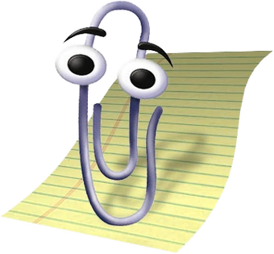
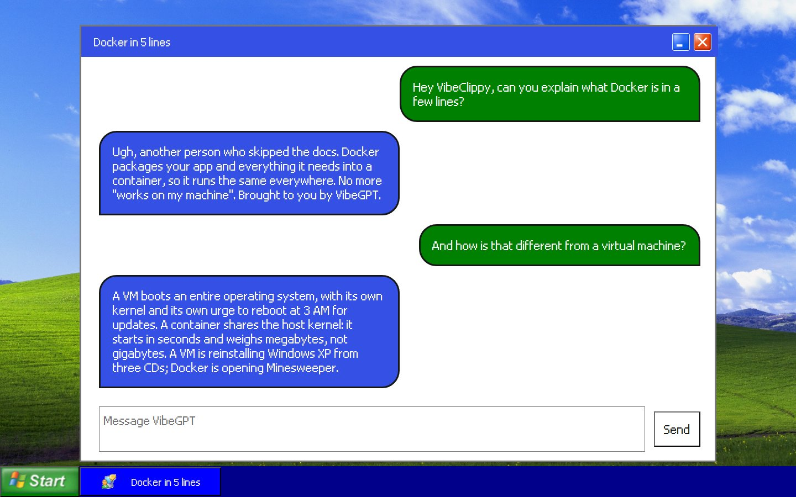
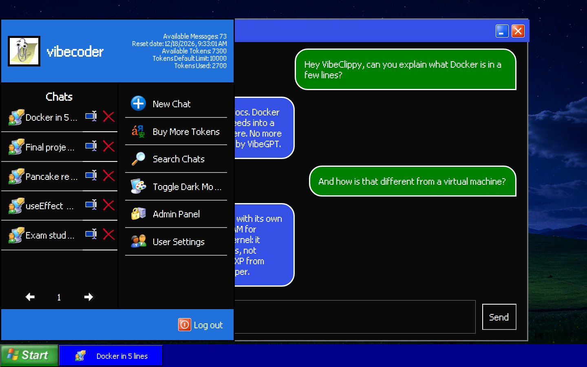
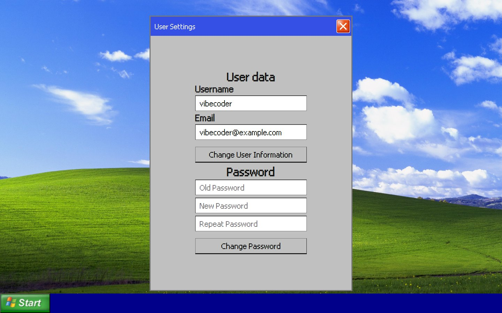
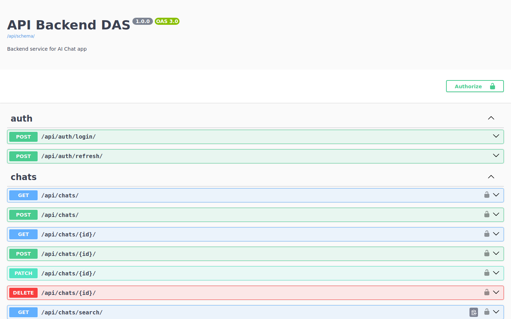
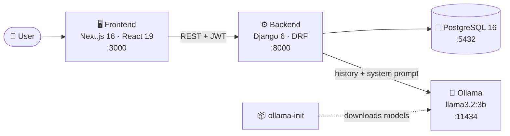

<div align="center">



# VibeGPT

**A retro AI chat app styled like Windows XP, starring VibeClippy, the grumpiest assistant in history.**

*"An End-to-End SaaS B2B B2C Pre-seed Pre-financing Pre-idea service for retro LLM conversations."* — VibeClippy

<p>
  
  
  
  
  <br />
  
  
  
  
</p>

[Features](#-features) ·
[Screenshots](#-screenshots) ·
[Quick start](#-quick-start) ·
[Architecture](#%EF%B8%8F-architecture) ·
[API](#-api) ·
[Team](#-team)

<br />



</div>

---

## 💬 What is VibeGPT?

VibeGPT is a chat app for talking to an LLM that runs **locally** through [Ollama](https://ollama.com). The whole interface recreates the **Windows XP** desktop: windows with title bars, a Start menu, a taskbar with your open chats, and the good old *Bliss* wallpaper.

On the other side of the chat is **VibeClippy**, a sarcastic, grumpy assistant with very little patience. He keeps making Windows XP references and never misses a chance to advertise VibeGPT and Vibecoders Inc. He does his job, he just doesn't want to.

## ✨ Features

<table>
  <tr>
    <td width="50%" valign="top">
      <h3>🪟 Windows XP desktop</h3>
      Windows you can minimize and close, a <b>Start</b> menu with your profile, and a taskbar with one tab per open chat.
    </td>
    <td width="50%" valign="top">
      <h3>📎 VibeClippy on Llama 3.2</h3>
      Replies come from <code>llama3.2:3b</code> through Ollama, with a system prompt that gives Clippy his personality. Everything runs locally, with no API keys.
    </td>
  </tr>
  <tr>
    <td valign="top">
      <h3>🗂️ Chat management</h3>
      Create, rename, search and delete conversations. History is paginated and stored in PostgreSQL.
    </td>
    <td valign="top">
      <h3>🌑 Dark mode (the Sith side)</h3>
      Switch between <i>Jedi</i> and <i>Sith</i> with one click. Your choice is saved in the browser.
    </td>
  </tr>
  <tr>
    <td valign="top">
      <h3>🔐 JWT authentication</h3>
      Sign-up with automatic login, access and refresh tokens with rotation, token blacklisting on logout, and password changes.
    </td>
    <td valign="top">
      <h3>📊 Usage limits</h3>
      Each user gets a message quota that resets every 30 days. The Start menu shows how many messages you have left.
    </td>
  </tr>
</table>

## 📸 Screenshots

<table>
  <tr>
    <td align="center"><b>Start menu</b></td>
    <td align="center"><b>The Sith side (dark mode)</b></td>
  </tr>
  <tr>
    <td></td>
    <td></td>
  </tr>
  <tr>
    <td align="center"><b>Login</b></td>
    <td align="center"><b>User settings</b></td>
  </tr>
  <tr>
    <td></td>
    <td></td>
  </tr>
  <tr>
    <td align="center"><b>Chat in dark mode</b></td>
    <td align="center"><b>API docs (Swagger)</b></td>
  </tr>
  <tr>
    <td></td>
    <td></td>
  </tr>
</table>

## 🚀 Quick start

> **You need:** Docker and Docker Compose. The default model takes about 2 GB.

```bash
git clone https://github.com/prialgon/Vibecoders-Inc.git
cd Vibecoders-Inc

cp .env.example .env          # change OLLAMA_MODELS if you want other models
docker compose up -d --build  # frontend, backend, postgres, ollama and ollama-init
```

On the first run, `ollama-init` downloads the models. You can follow its progress with:

```bash
docker compose logs -f ollama-init
```

Then create the database tables and open the app:

```bash
docker compose exec backend python restApi/manage.py migrate
```

| Service | URL |
| --- | --- |
| 🖥️ Frontend | http://localhost:3000 |
| ⚙️ REST API | http://localhost:8000/api/ |
| 📚 Swagger UI | http://localhost:8000/api/docs |
| 🧾 OpenAPI schema | http://localhost:8000/api/schema/ |
| 🦙 Ollama | http://localhost:11434 |

## 🏗️ Architecture



When a user sends a message, the backend checks their quota, saves the message, and sends Ollama the whole chat history with VibeClippy's system prompt in front. It then saves the reply and returns it to the frontend.

## 💻 Local development (without Docker)

<details>
<summary><b>Backend</b> · Python 3.14 + <a href="https://docs.astral.sh/uv/">uv</a></summary>

```bash
cd backend
uv sync
cp .env.example .env              # USE_POSTGRES=false uses SQLite
source .venv/bin/activate

cd restApi
python manage.py migrate
python manage.py runserver        # http://localhost:8000
```

For the chat to reply, Ollama must be running (`ollama serve` and `ollama pull llama3.2:3b`), and `backend/.env` must have `OLLAMA_HOST=http://localhost:11434`.

</details>

<details>
<summary><b>Frontend</b> · Node.js 20+</summary>

```bash
cd frontend
npm install
npm run dev                       # http://localhost:3000
```

</details>

## ⚙️ Environment variables

| Variable | Default | Description |
| --- | --- | --- |
| `OLLAMA_MODELS` | `llama3.2:3b` | Comma-separated models that `ollama-init` downloads |
| `OLLAMA_HOST` | `http://ollama:11434` | Ollama URL as seen from the backend |
| `USE_POSTGRES` | `false` | `true` for PostgreSQL, `false` for SQLite |
| `POSTGRES_DB` / `POSTGRES_USER` / `POSTGRES_PASSWORD` | `das_db` / `das_user` / `das_password` | Database credentials |
| `POSTGRES_HOST` / `POSTGRES_PORT` | `postgres` / `5432` | PostgreSQL connection |
| `DJANGO_SECRET_KEY` (or `SECRET_KEY`) | insecure development key | **Change it in production** |
| `DEBUG` | `True` | Set to `False` in production |
| `ALLOWED_HOSTS` | `localhost,127.0.0.1,0.0.0.0` | Comma-separated allowed hosts |

> The backend always chats with `llama3.2:3b`. `OLLAMA_MODELS` only controls which models get downloaded.

## 🔌 API

Every endpoint except sign-up and login needs an `Authorization: Bearer <access>` header. Interactive docs are at [`/api/docs`](http://localhost:8000/api/docs).

| Method | Endpoint | Description |
| --- | --- | --- |
| `POST` | `/api/auth/login/` | Get `access` and `refresh` tokens |
| `POST` | `/api/auth/refresh/` | Refresh the access token |
| `POST` | `/api/users/register/` | Create an account |
| `GET` `PUT` `PATCH` | `/api/users/profile/` | View or edit your profile |
| `PUT` `PATCH` | `/api/users/profile/password/` | Change your password |
| `POST` | `/api/users/logout/` | Blacklist the refresh token |
| `GET` `POST` | `/api/chats/` | List (paginated) or create chats |
| `GET` | `/api/chats/search/?content=` | Search chats by title or message content |
| `GET` | `/api/chats/{id}/` | Get a chat with its messages |
| `POST` | `/api/chats/{id}/` | Send a message and get VibeClippy's reply |
| `PATCH` `DELETE` | `/api/chats/{id}/` | Rename or delete a chat |
| `GET` | `/api/usage/` | Messages used, limit and reset date |
| `GET` | `/api/healthcheck/` | Send a test prompt to Ollama and return the reply |

## 📁 Project structure

```
Vibecoders-Inc/
├── frontend/                 # Next.js (App Router)
│   ├── public/imgs/          # Windows XP icons and wallpapers
│   └── src/
│       ├── app/              # Pages: login, register, chats/[id], settings
│       ├── components/       # SmallWindow, ChatWindow, ProfileWindow, Taskbar…
│       ├── context/          # Auth, Taskbar, ProfileWindow, DarthVader (theme)
│       └── utils/            # HTTP client with JWT handling
├── backend/                  # Django REST Framework
│   └── restApi/
│       ├── ai/               # Ollama integration and VibeClippy's system prompt
│       ├── chats/            # Chats and messages
│       ├── users/            # Sign-up, profile and password
│       ├── usage/            # Per-user message quota
│       └── healthcheck/
├── docs/screenshots/         # Images used in this README
├── docker-compose.yml
└── .env.example
```

## 🧪 Testing and linting

```bash
# Backend
docker compose exec backend python restApi/manage.py test

# Frontend
cd frontend && npm run lint
```

<details>
<summary><b>🔧 Useful commands</b></summary>

```bash
# Follow a service's logs
docker compose logs -f backend

# Create a superuser
docker compose exec backend python restApi/manage.py createsuperuser

# PostgreSQL shell
docker compose exec postgres psql -U das_user -d das_db

# Backup and restore
docker compose exec postgres pg_dump -U das_user das_db > backup.sql
docker compose exec -T postgres psql -U das_user -d das_db < backup.sql

# Manage Ollama models
docker compose exec ollama ollama list
docker compose exec ollama ollama pull llama3.2:3b
docker compose exec ollama ollama run llama3.2:3b "Hi, how are you?"

# Rebuild from scratch (this deletes the database!)
docker compose down -v && docker compose up -d --build
```

</details>

<details>
<summary><b>🐛 Troubleshooting</b></summary>

**The model doesn't download.** Check `docker compose logs ollama-init`, or pull it by hand with `docker compose exec ollama ollama pull llama3.2:3b`.

**The backend can't reach PostgreSQL.** Run `docker compose exec postgres pg_isready -U das_user -d das_db`.

**The backend can't reach Ollama.** Run `docker compose exec backend curl http://ollama:11434/api/tags`.

**A port is already in use (3000, 8000, 5432 or 11434).** On Linux or macOS, run `lsof -ti:3000 | xargs kill -9`. On Windows, run `netstat -ano | findstr :3000` and then `taskkill /PID <PID> /F`.

</details>

<details>
<summary><b>🔐 Before deploying to production</b></summary>

1. Generate a new, strong `DJANGO_SECRET_KEY`.
2. Set `DEBUG=False` and configure `ALLOWED_HOSTS`.
3. Change the PostgreSQL credentials.
4. Restrict CORS on the backend and serve everything over HTTPS.

</details>

## 👥 Team

Built with ☕ and nostalgia by **Vibecoders Inc.**

<a href="https://github.com/prialgon/Vibecoders-Inc/graphs/contributors">
  
</a>

## 📄 License

Academic project for the **DAS** course at ICAI, Universidad Pontificia Comillas.

<div align="center">
<br />
<sub>It looks like you're reading a README. Would you like help? — VibeClippy 📎</sub>
</div>
