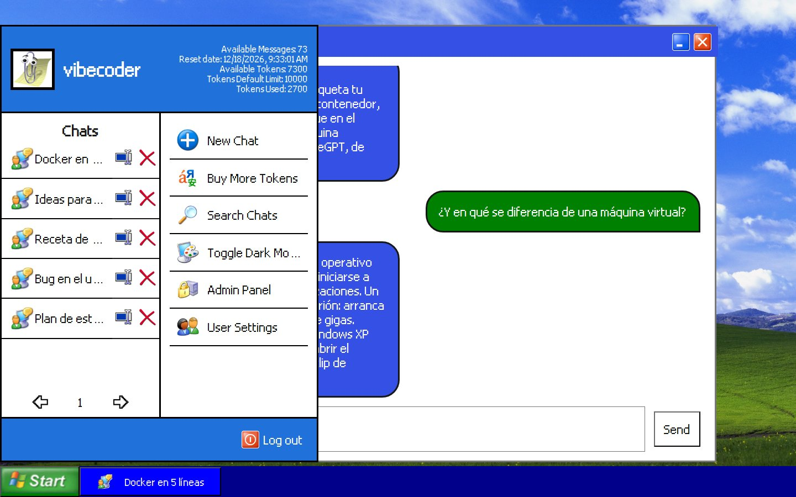
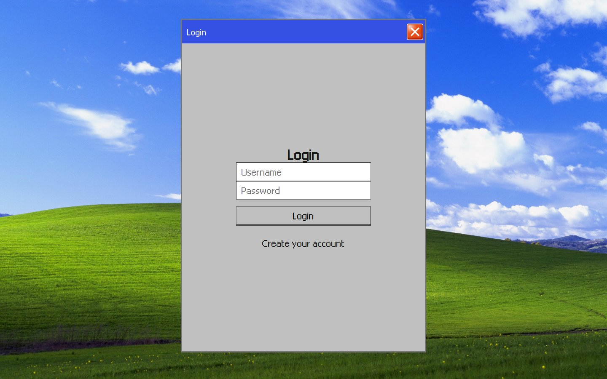
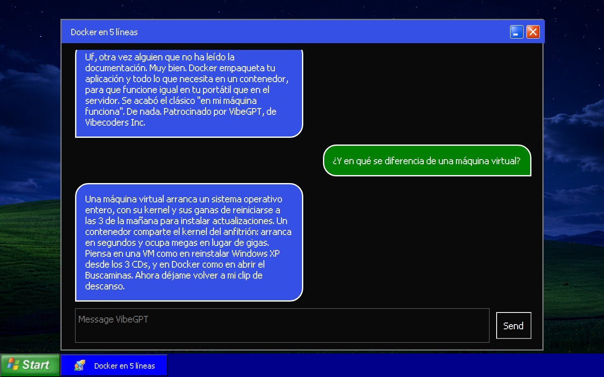
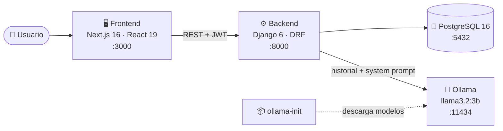

<div align="center">


# VibeGPT

**Chat con IA retro al estilo Windows XP, presentado por VibeClippy: el asistente más gruñón de la historia.**

*Un servicio End-to-End SaaS B2B B2C Pre-seed Pre-financing Pre-idea de conversación con LLMs retro.* — VibeClippy

<p>
  
  
  
  
  <br />
  
  
  
  
</p>

[Características](#-características) ·
[Capturas](#-capturas) ·
[Quick start](#-quick-start) ·
[Arquitectura](#%EF%B8%8F-arquitectura) ·
[API](#-api) ·
[Equipo](#-equipo)

<br />


</div>

---

## 💬 ¿Qué es VibeGPT?

VibeGPT es una aplicación de chat con un LLM que se ejecuta **en local** con [Ollama](https://ollama.com). Toda la interfaz imita el escritorio de **Windows XP**: ventanas con barra de título, menú Inicio, barra de tareas con los chats abiertos y el fondo *Bliss* de toda la vida.

Al otro lado está **VibeClippy**, un asistente sarcástico, gruñón y con poca paciencia. Hace referencias constantes a Windows XP y no pierde ninguna ocasión de hacer publicidad de VibeGPT y de Vibecoders Inc. Hace su trabajo, aunque no le apetezca nada.

## ✨ Características

<table>
  <tr>
    <td width="50%" valign="top">
      <h3>🪟 Escritorio Windows XP</h3>
      Ventanas que se pueden minimizar y cerrar, un menú <b>Inicio</b> con tu perfil y una barra de tareas con una pestaña por cada chat abierto.
    </td>
    <td width="50%" valign="top">
      <h3>📎 VibeClippy con Llama 3.2</h3>
      Las respuestas las genera <code>llama3.2:3b</code> a través de Ollama, con un <i>system prompt</i> que le da su personalidad. Todo en local y sin claves de API.
    </td>
  </tr>
  <tr>
    <td valign="top">
      <h3>🗂️ Gestión de chats</h3>
      Puedes crear, renombrar, buscar y borrar conversaciones. El historial está paginado y se guarda en PostgreSQL.
    </td>
    <td valign="top">
      <h3>🌑 Modo oscuro (Lado Sith)</h3>
      Puedes cambiar entre <i>jedi</i> y <i>sith</i> con un clic. La preferencia se guarda en el navegador.
    </td>
  </tr>
  <tr>
    <td valign="top">
      <h3>🔐 Autenticación JWT</h3>
      Registro con inicio de sesión automático, tokens de acceso y de refresco con rotación, <i>blacklist</i> al cerrar sesión y cambio de contraseña.
    </td>
    <td valign="top">
      <h3>📊 Límite de uso</h3>
      Cada usuario tiene un cupo de mensajes que se reinicia cada 30 días. Desde el menú Inicio ves cuántos te quedan.
    </td>
  </tr>
</table>

## 📸 Capturas

<table>
  <tr>
    <td align="center"><b>Menú Inicio</b></td>
    <td align="center"><b>Lado Sith (modo oscuro)</b></td>
  </tr>
  <tr>
    <td></td>
    <td></td>
  </tr>
  <tr>
    <td align="center"><b>Inicio de sesión</b></td>
    <td align="center"><b>Ajustes de usuario</b></td>
  </tr>
  <tr>
    <td></td>
    <td></td>
  </tr>
  <tr>
    <td align="center"><b>Chat en modo oscuro</b></td>
    <td align="center"><b>Documentación de la API (Swagger)</b></td>
  </tr>
  <tr>
    <td></td>
    <td></td>
  </tr>
</table>

## 🚀 Quick start

> **Requisitos:** Docker y Docker Compose. El modelo por defecto ocupa unos 2 GB.

```bash
git clone https://github.com/prialgon/Vibecoders-Inc.git
cd Vibecoders-Inc

cp .env.example .env          # ajusta OLLAMA_MODELS si quieres otros modelos
docker compose up -d --build  # frontend, backend, postgres, ollama y ollama-init
```

La primera vez, `ollama-init` descarga los modelos. Puedes seguir el progreso con:

```bash
docker compose logs -f ollama-init
```

Después, crea las tablas y abre la app:

```bash
docker compose exec backend python restApi/manage.py migrate
```

| Servicio | URL |
| --- | --- |
| 🖥️ Frontend | http://localhost:3000 |
| ⚙️ API REST | http://localhost:8000/api/ |
| 📚 Swagger UI | http://localhost:8000/api/docs |
| 🧾 Esquema OpenAPI | http://localhost:8000/api/schema/ |
| 🦙 Ollama | http://localhost:11434 |

## 🏗️ Arquitectura



Cuando el usuario envía un mensaje, el backend comprueba su cupo de uso, guarda el mensaje y envía a Ollama todo el historial del chat precedido del *system prompt* de VibeClippy. Después guarda la respuesta y la devuelve al frontend.

## 💻 Desarrollo local (sin Docker)

<details>
<summary><b>Backend</b> · Python 3.14 + <a href="https://docs.astral.sh/uv/">uv</a></summary>

```bash
cd backend
uv sync
cp .env.example .env              # USE_POSTGRES=false usa SQLite
source .venv/bin/activate

cd restApi
python manage.py migrate
python manage.py runserver        # http://localhost:8000
```

Para que el chat responda, necesitas Ollama en marcha (`ollama serve` y `ollama pull llama3.2:3b`) y `OLLAMA_HOST=http://localhost:11434` en `backend/.env`.

</details>

<details>
<summary><b>Frontend</b> · Node.js 20+</summary>

```bash
cd frontend
npm install
npm run dev                       # http://localhost:3000
```

</details>

## ⚙️ Variables de entorno

| Variable | Por defecto | Descripción |
| --- | --- | --- |
| `OLLAMA_MODELS` | `llama3.2:3b` | Modelos que descarga `ollama-init`, separados por comas |
| `OLLAMA_HOST` | `http://ollama:11434` | URL de Ollama vista desde el backend |
| `USE_POSTGRES` | `false` | `true` para PostgreSQL, `false` para SQLite |
| `POSTGRES_DB` / `POSTGRES_USER` / `POSTGRES_PASSWORD` | `das_db` / `das_user` / `das_password` | Credenciales de la base de datos |
| `POSTGRES_HOST` / `POSTGRES_PORT` | `postgres` / `5432` | Conexión a PostgreSQL |
| `DJANGO_SECRET_KEY` (o `SECRET_KEY`) | clave insegura de desarrollo | **Cámbiala en producción** |
| `DEBUG` | `True` | Pon `False` en producción |
| `ALLOWED_HOSTS` | `localhost,127.0.0.1,0.0.0.0` | Hosts permitidos, separados por comas |

## 🔌 API

Todos los endpoints, salvo el registro y el login, requieren `Authorization: Bearer <access>`. La documentación interactiva está en [`/api/docs`](http://localhost:8000/api/docs).

| Método | Endpoint | Descripción |
| --- | --- | --- |
| `POST` | `/api/auth/login/` | Obtiene los tokens `access` y `refresh` |
| `POST` | `/api/auth/refresh/` | Renueva el token de acceso |
| `POST` | `/api/users/register/` | Crea una cuenta |
| `GET` `PUT` `PATCH` | `/api/users/profile/` | Consulta o edita el perfil |
| `PUT` `PATCH` | `/api/users/profile/password/` | Cambia la contraseña |
| `POST` | `/api/users/logout/` | Invalida el token de refresco |
| `GET` `POST` | `/api/chats/` | Lista (paginada) o crea chats |
| `GET` | `/api/chats/search/?content=` | Busca chats por título o por el contenido de sus mensajes |
| `GET` | `/api/chats/{id}/` | Devuelve un chat con sus mensajes |
| `POST` | `/api/chats/{id}/` | Envía un mensaje y recibe la respuesta de VibeClippy |
| `PATCH` `DELETE` | `/api/chats/{id}/` | Renombra o borra un chat |
| `GET` | `/api/usage/` | Mensajes usados, límite y fecha de reinicio |
| `GET` | `/api/healthcheck/` | Envía un prompt de prueba a Ollama y devuelve la respuesta |

## 📁 Estructura

```
Vibecoders-Inc/
├── frontend/                 # Next.js (App Router)
│   ├── public/imgs/          # Iconos y fondos de Windows XP
│   └── src/
│       ├── app/              # Páginas: login, register, chats/[id], settings
│       ├── components/       # SmallWindow, ChatWindow, ProfileWindow, Taskbar…
│       ├── context/          # Auth, Taskbar, ProfileWindow, DarthVader (tema)
│       └── utils/            # Cliente HTTP con JWT
├── backend/                  # Django REST Framework
│   └── restApi/
│       ├── ai/               # Integración con Ollama y system prompt de VibeClippy
│       ├── chats/            # Chats y mensajes
│       ├── users/            # Registro, perfil y contraseña
│       ├── usage/            # Cupo de mensajes por usuario
│       └── healthcheck/
├── docs/screenshots/         # Capturas de este README
├── docker-compose.yml
└── .env.example
```

## 🧪 Testing y calidad

```bash
# Backend
docker compose exec backend python restApi/manage.py test

# Frontend
cd frontend && npm run lint
```

<details>
<summary><b>🔧 Comandos útiles</b></summary>

```bash
# Logs de un servicio
docker compose logs -f backend

# Crear superusuario
docker compose exec backend python restApi/manage.py createsuperuser

# Shell de PostgreSQL
docker compose exec postgres psql -U das_user -d das_db

# Backup y restauración
docker compose exec postgres pg_dump -U das_user das_db > backup.sql
docker compose exec -T postgres psql -U das_user -d das_db < backup.sql

# Gestionar modelos de Ollama
docker compose exec ollama ollama list
docker compose exec ollama ollama pull llama3.2:3b
docker compose exec ollama ollama run llama3.2:3b "Hola, ¿cómo estás?"

# Reconstruir desde cero (¡borra la base de datos!)
docker compose down -v && docker compose up -d --build
```

</details>

<details>
<summary><b>🐛 Troubleshooting</b></summary>

**El modelo no se descarga.** Revisa `docker compose logs ollama-init` o descárgalo a mano con `docker compose exec ollama ollama pull llama3.2:3b`.

**El backend no conecta con PostgreSQL.** Comprueba `docker compose exec postgres pg_isready -U das_user -d das_db`.

**El backend no conecta con Ollama.** Prueba `docker compose exec backend curl http://ollama:11434/api/tags`.

**Puerto ocupado (3000, 8000, 5432 u 11434).** En Linux o macOS, `lsof -ti:3000 | xargs kill -9`. En Windows, `netstat -ano | findstr :3000` y después `taskkill /PID <PID> /F`.

</details>

<details>
<summary><b>🔐 Antes de desplegar en producción</b></summary>

1. Genera una `DJANGO_SECRET_KEY` nueva y segura.
2. Pon `DEBUG=False` y ajusta `ALLOWED_HOSTS`.
3. Cambia las credenciales de PostgreSQL.
4. Restringe CORS en el backend y sirve todo por HTTPS.

</details>

## 👥 Equipo

Hecho con ☕ y nostalgia por **Vibecoders Inc.**

<a href="https://github.com/prialgon/Vibecoders-Inc/graphs/contributors">
  
</a>

## 📄 Licencia

Proyecto académico de la asignatura **DAS** (ICAI, Universidad Pontificia Comillas).

<div align="center">
<br />
<sub>Parece que estás leyendo un README. ¿Quieres ayuda? — VibeClippy 📎</sub>
</div>
